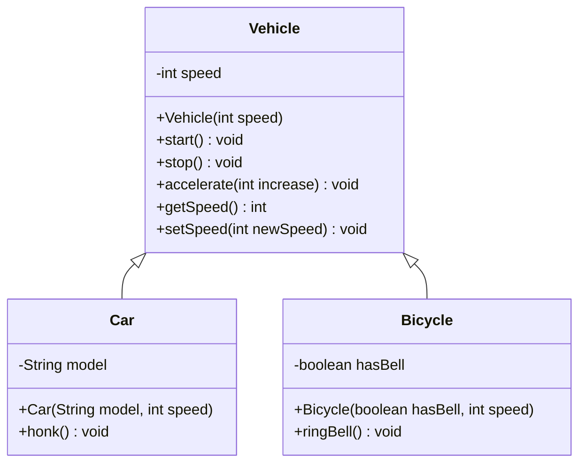

# Inheritance and interfaces

This week, we will deepen our object-oriented programming skills by exploring inheritance and interfaces. Inheritance and interfaces are object-oriented solutions that promote code reusability and compatibility.

## Recommended materials

- [Objects, Classes, Interfaces, Packages, and Inheritance (dev.java)](https://dev.java/learn/oop/)
- [Java Polymorphism Fully Explained In 7 Minutes (Coding with John, YouTube)](https://youtu.be/jhDUxynEQRI)
- [Super Keyword in Java Full Tutorial - How to Use "super" (Coding with John, YouTube)](https://www.youtube.com/watch?v=Qb_NUn0TSAU)
- [Lesson examples](https://github.com/hh-programming-2/lessons?tab=readme-ov-file#lesson-4-object-modelling-inheritance-and-interfaces)