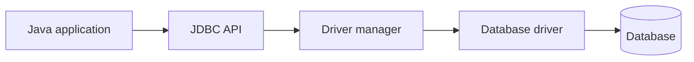

# Database programming

This week, we will start by learning how to establish a connection to a database from a Java program and perform basic CRUD operations (Create, Read, Update, & Delete). We will also explore the DAO (Data Access Object) design pattern, which models both database operations and the data contained in the database using Java classes.

## Recommended materials

- [Java Database Connectivity (Telusko, YouTube)](https://youtu.be/7v2OnUti2eM)
- [Introduction to JDBC (baeldung.com)](https://www.baeldung.com/java-jdbc)
- [Lesson examples](https://github.com/hh-programming-2/lessons?tab=readme-ov-file#lesson-6-database-connection-with-java-jdbc)